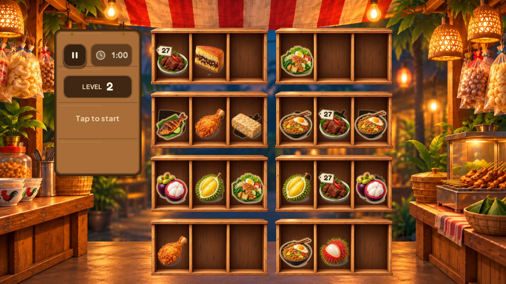
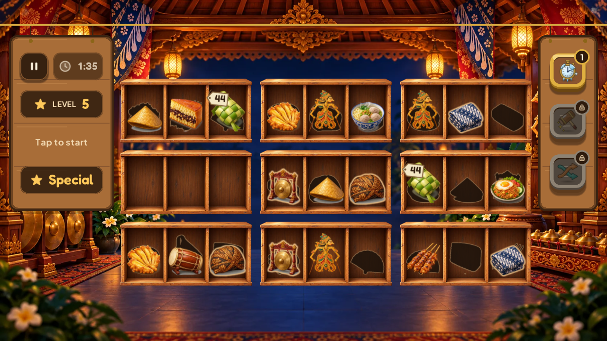
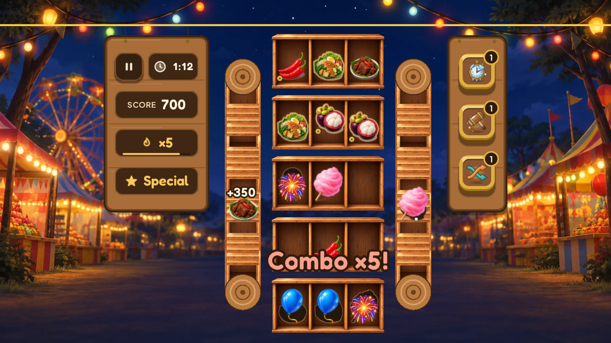
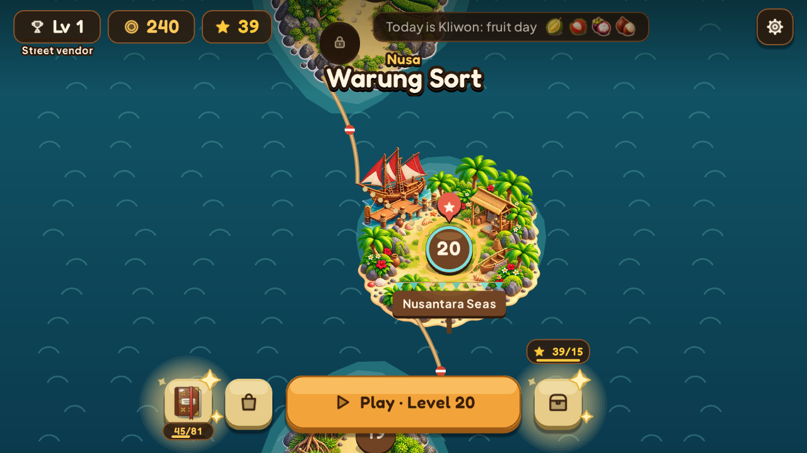

# Nusa: Warung Sort

A browser puzzle game about tidying up an Indonesian *warung* (a small corner shop): drag food between shelves and clear it in matching sets of three. It is a casual "goods sort" game for anyone who likes short, relaxed puzzles, and it runs in desktop and mobile browsers, in portrait or landscape.

**Play it:** [kokeskill.itch.io/nusa-warung-sort](https://kokeskill.itch.io/nusa-warung-sort)

| | |
|---|---|
|  |  |
|  |  |

## Features

- 50 hand-reviewed levels on an island map, with 10 themes (Javanese culture, a night market, the sea, spice islands…).
- Mechanics introduced one at a time: layers waiting behind each shelf, crates, fixed stacks, a conveyor belt, shelves that close, and fresh food that spoils if left too long.
- Stars, coins, star chests and three boosters (freeze the clock, shuffle, remove a triple). Every level can be cleared without boosters; nothing is sold for real money.
- *Pasaran*: the Javanese five-day market week changes which items pay extra each day.
- *Buku Nenek* ("Grandma's book"): a collection of 81 illustrated items with short notes about each food or object.
- English and Indonesian, chosen from the browser's language.
- Progress saved locally in the browser (`localStorage`); no accounts, no backend.

## Stack

- [Phaser 4](https://phaser.io) for rendering and input
- TypeScript (strict) and [Vite](https://vite.dev)
- [Vitest](https://vitest.dev) for tests
- Small Python and Node scripts in `tools/` for the level generator, art and audio pipelines, and checks

## Requirements

- Node.js 22 or newer (developed with Node 24) and npm
- Optional, only for the asset pipelines: Python 3 with Pillow (art) and ffmpeg (audio, videos)
- Optional, for `npm run check:flow`: Playwright's headless Chromium (`npx playwright install chromium-headless-shell`), or any Chrome given in `CHROME=`

## Install and run

```bash
npm install
npm run dev        # http://localhost:5180, also reachable from your local network
```

Other commands:

```bash
npm run build      # typecheck + production build in dist/ (no SDK, no ads)
npm run preview    # serve dist/
npm run build:poki # the build for the Poki portal in dist-poki/, with its SDK and ads
```

The game needs no environment variables or secrets. `.env.poki` only switches the Poki build mode on; see `.env.example`.

In development, query parameters open specific screens, for example `?level=12` (any level), `?gallery` (all items) or `?uikit` (the UI kit). The full list is in [CLAUDE.md](CLAUDE.md) (in Spanish).

## Tests

```bash
npm test           # Vitest: game rules, level data, economy, save format, services
npm run typecheck  # tsc --noEmit
npm run check:flow # with npm run dev running: plays map → level → win → map in headless Chrome
```

## Project structure

```
src/core       game rules in pure TypeScript (no Phaser), fully unit-tested
src/scenes     Phaser scenes: they draw the state and send actions to the core
src/services   boundaries with the outside world: save, sound, ads, portal events, haptics
src/data       levels, themes, item catalogue, economy values
src/i18n       English and Indonesian texts
src/ui         layout helpers and design tokens
tests          Vitest tests and demo-level fixtures
tools          level generator, simulated players, art/audio pipelines, release checks
docs           style guide, audio licences, launch notes (mostly in Spanish)
```

Levels are not drawn by hand: `tools/levelgen` builds them from short recipes, and simulated players check that each one can be won without boosters and sits in its difficulty band. The results are reviewed and committed in `src/data/levels`.

## How AI was used

I designed the game, directed the work, played and tuned every level, and reviewed every change. I used AI tools heavily to build it, and I want to be clear about where:

- **Code:** most of the code, tests and tools were written with [Claude Code](https://claude.com/claude-code) working on my instructions. Nearly every commit carries a `Co-Authored-By: Claude` trailer, so the history shows this openly. Design decisions, playtesting and acceptance were mine.
- **Art:** the illustrated items, shelves, backgrounds and island art were generated with ChatGPT from my prompts, then selected, cleaned up and prepared for the game with scripts in `tools/art`. Covers and screenshots are composed by code from that art. UI icons are hand-specified SVG.
- **Text:** in-game texts, the *Buku Nenek* notes and the Indonesian translation were drafted with AI; I reviewed them, and a native speaker reviewed the Indonesian.
- **Not AI:** the levels come from a deterministic procedural generator and simulated players, not from a model. The game makes no AI calls while you play. The game's own build sends no data anywhere; the Poki build only talks to Poki's SDK.

## Credits and licence

Fonts, sounds and music are third-party works under open licences; see [ASSETS.md](ASSETS.md).

The code is released under the [MIT License](LICENSE). Plans for future work are in [ROADMAP.md](ROADMAP.md).
